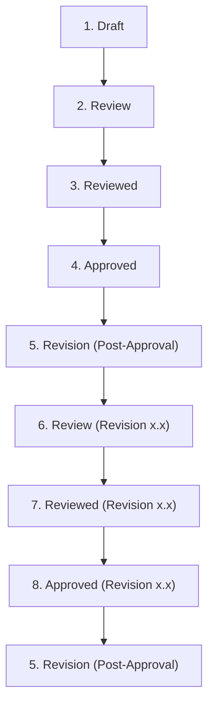

# Design Document Lifecycle Workflow (All Design Documents)

Every design document passes through the following document-control phases. This applies to **all** design document types:

| Document Type | File Pattern | Location | Status Field |
| :--- | :--- | :--- | :--- |
| High Level Design | `*_HLD.md` | `design/` | `Design Status` |
| Low Level Design | `*_LLD.md` | `design/epic/` | `Design Status` |
| Feature Design | `<Feature ID>_design_document.md` | `design/epic/features/` | `Design Status` |
| Bug Design | `<Bug ID>_bug_design.md` | `design/epic/bugs/` | `Status` |
| Test Plan | `*_TEST_PLAN.md` | `design/` | `Status` |
| Test Cases | `*_TEST_CASES.md` | `design/` or `tests/` | `Status` |
| Project Analysis | `*_Project_Analysis.md` | `design/` | `Analysis Status` |
| Compliance | `*_COMPLIANCE.md` or `<Framework>_compliance.md` | `compliance/` or `docs/compliance/` | `Compliance Status` |
| Documentation | `*_DOCUMENTATION.md` or `<Guide Name>_doc.md` | `docs/` or `design/` | `Documentation Status` |
| Ops | `*_OPS.md` or `<Runbook Name>_ops.md` | `ops/` or `docs/ops/` | `Ops Status` |

### Phase 1 — Draft

The document is being written section-by-section with the User. The model proposes each section, the User confirms, then the next section begins. Status = `Draft`. No review has been requested.

### Phase 2 — Review

The document is submitted to reviewers. Findings are recorded as Acceptable / Minor / Major. Major findings trigger push-back with specific, actionable comments and a concrete path forward. Status = `In Review`.

### Phase 3 — Reviewed

Review is complete. A human reviewer (not the author, not an AI agent) has signed off the Document Control block. Status = `Reviewed`.

### Phase 4 — Approved

Formal approval is granted. A review file must be generated per the Review File Generation & Naming schema (`<epic>_<doc-level>_<review-number>.md`). Status = `Approved`.

### Phase 5 — Revision (Post-Approval)

After approval, any change returns the document to revision mode. A new revision version (x.x) is opened. The Document Control status returns to a draft/review state for that revision (e.g. `Draft v1.1` or `In Review v1.1`).

### Phase 6 — Review (Revision x.x)

The revised document re-enters review for the changes in revision x.x only. Status = `In Review v<x.x>`.

### Phase 7 — Reviewed (Revision x.x)

Revision review is complete; the human reviewer signs off revision x.x. Status = `Reviewed v<x.x>`.

### Phase 8 — Approved (Revision x.x)

Formal approval of revision x.x is granted. A new review file is generated for that revision (`<epic>_<doc-level>_<review-number>.md`). Status = `Approved v<x.x>`.

### Revision Flow Diagram

### Rules

- **Applies to all design documents**: HLD, LLD, Feature Design, Bug Design, Test Plan, Test Cases, and Project Analysis all follow the same 8-phase lifecycle.
- **No self-approval**: the author or an AI agent may not approve or set status to Approved on their own document.
- **Section-by-section**: Drafts must be confirmed with the User at each section boundary before the next section is written.
- **Review file required**: no document is considered officially reviewed until its `<epic>_<doc-level>_<review-number>.md` review file exists.
- **Revision requires re-review**: post-approval changes must cycle through Review → Reviewed → Approved for the new revision version.
- **Templates**: the Document Control status field in every design template must reflect the current phase (Draft / In Review / Reviewed / Approved / Draft v<x.x> / In Review v<x.x> / Reviewed v<x.x> / Approved v<x.x>).
- **Comment Template**: every design document's comment section references `templates/COMMENTS_TEMPLATE.md` for the comments file location format (`<Project Acronym>_<File Being Reviewed>_Comments.md`).
- **Reviewed by and Comments required**: Every design document must include a "Reviewed by and Comments" section immediately before Section 8 (Decision & Approval), containing:
  - **7.1 Reviewers**: A table with columns Reviewer / Role / Date / Comments, listing every reviewer who evaluated the document.
  - **7.2 Comment Section**: Three fields — File location, Created Date, and Modified Date — documenting where review comments are stored.

**Document-level (`<doc-level>`) values for review file naming:** `hld`, `lld`, `feature-design`, `bug-design`, `test-plan`, `test-cases`, `project-analysis`, `compliance`, `documentation`, `ops`.
