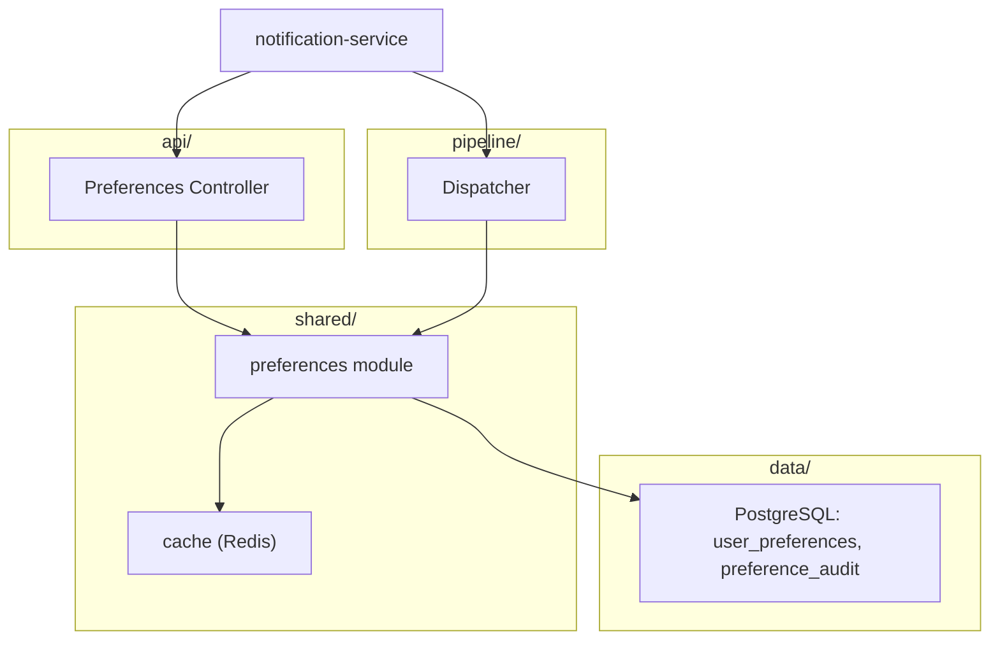
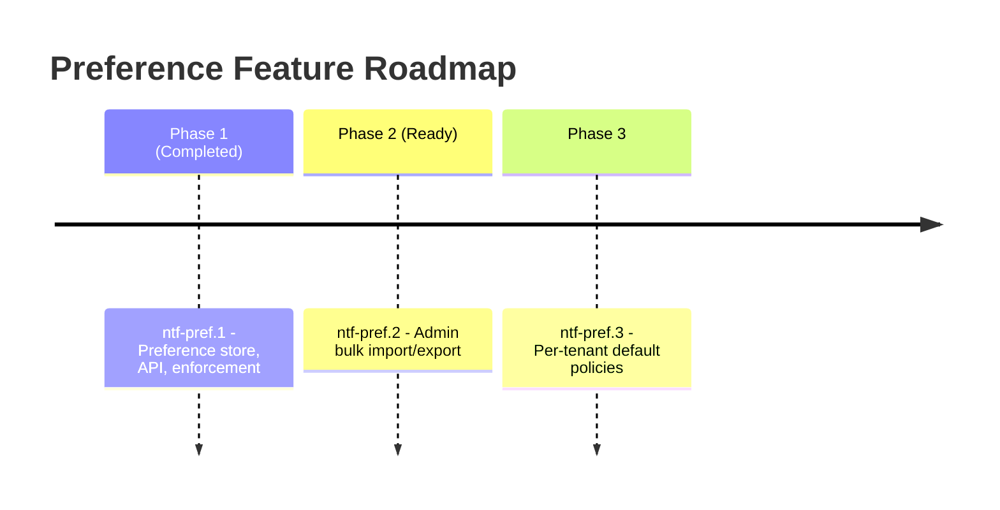

# Feature Design Document: Per-User Notification Preference and Opt-Out Management

**Task ID**: `ntf-pref.1`
**Parent Epic**: `ntf-pref` (Notification Preferences & Compliance)
**Implements HLD Section**: ntf_hld §1.3 (NTF-REQ-002, NTF-REQ-004)
**Related Low Level Design**: `design_example/epic_example/ntf-pref_LLD.md`
**Status**: Approved
**Target Languages / Runtimes**: TypeScript (Node.js 20 LTS)
**Build Tool / Version**: pnpm 9.x, Turborepo
**Framework Stack**: Fastify 4, Prisma 5, PostgreSQL 16, Redis 7
**Affected Modules / Components**: `shared/preferences`, `api/preferences`, `pipeline/dispatcher`

---

## Document Control

| Field | Value |
| :--- | :--- |
| Version | v1.0 |
| Design Status | Approved v1.0 |
| Date Created | 10/18/26 |
| Date Last Updated | 10/22/26 |
| Author | Alex Rivera (alex.rivera@example.com) |
| Reviewers | Sam Okonkwo, Priya Shah |
| Required Approvers | Alex Rivera – Tech Lead – 10/20/26 |

---

## 1. Header / Metadata

- **Title**: Per-User Notification Preference and Opt-Out Management
- **Task ID**: `ntf-pref.1`
- **Parent Epic**: `ntf-pref` (Notification Preferences & Compliance)
- **Status**: Approved
- **Author**: Alex Rivera
- **Reviewers**: Sam Okonkwo, Priya Shah
- **Date Created**: 10/18/26
- **Date Last Updated**: 10/22/26
- **Target Languages / Runtimes**: TypeScript (Node.js 20 LTS)
- **Build Tool / Version**: pnpm 9.x, Turborepo
- **Framework Stack**: Fastify 4, Prisma 5, PostgreSQL 16, Redis 7
- **Affected Modules / Components**: `shared/preferences`, `api/preferences`, `pipeline/dispatcher`

---

## 2. Executive Summary

This feature delivers per-user notification preference and opt-out management, satisfying **NTF-REQ-002** (user opt-out and channel preference management for GDPR/CCPA compliance) and supporting **NTF-REQ-004** (audit trail of notification attempts).

Today, notification channel selection is hard-coded per template with no user-level override. Users cannot disable marketing emails while keeping transactional emails, and there is no recorded consent/opt-out history. This creates compliance risk and poor UX.

`ntf-pref.1` establishes:
1. A `user_preferences` store with per-user, per-channel, per-category opt-in/opt-out state.
2. A preference API (`GET/PUT /v1/preferences`) for users and an internal gRPC service for the dispatcher.
3. Enforcement in the dispatch pipeline: messages are dropped (and audited) when a user has opted out of the channel or category.
4. An immutable audit log of preference changes for compliance review.
5. Caching (Redis) with short TTL to keep dispatch latency low while staying consistent.

---

## 3. Target Architecture & Project Structure

### 3.1 Module / Component Hierarchy



### 3.2 Filesystem Layout

```
notification-service/
├── src/
│   ├── api/preferences/          # REST handlers
│   ├── shared/preferences/       # domain logic + repository
│   ├── pipeline/dispatcher/      # consumes preference checks
│   └── config/
├── migrations/
│   └── 0003_user_preferences.sql
├── tests/
│   ├── preferences.api.test.ts
│   └── preferences.dispatcher.test.ts
└── ...
```

### 3.3 Module / Component Responsibilities

#### `shared/preferences`
- **Purpose**: Domain logic, repository, cache, audit logging.
- **Stack**: Prisma, Redis (ioredis).
- **Follow-ups**: `ntf-pref.2` (admin bulk preference import).

#### `api/preferences`
- **Purpose**: REST endpoints for user self-service.
- **Stack**: Fastify, Zod validation.

#### `pipeline/dispatcher`
- **Purpose**: Enforces preferences before delivery; emits audit on drop.

### 3.4 Design Patterns Used

#### Repository
> **Pattern**:
> ```mermaid
> classDiagram
>     class PreferenceRepository { <<interface>> +find(userId) +save(p) }
>     class PostgresPreferenceRepository
>     PreferenceRepository <|.. PostgresPreferenceRepository
> ```
> **Why Chosen**: Abstracts data access for preferences/audit, enabling caching and test doubles.

#### Cache-Aside
> **Pattern**:
> ```mermaid
> flowchart LR
>     App --> Cache[(Redis)]
>     Cache -- miss --> DB[(PostgreSQL)]
>     DB --> Cache
> ```
> **Why Chosen**: Keeps dispatch latency low (target >95% hit rate) while preserving consistency via invalidation on write.

#### Strategy
> **Pattern**:
> ```mermaid
> classDiagram
>     class PreferenceCheck { <<interface>> +check(userId, channel, category) }
>     class CachedPreferenceCheck
>     PreferenceCheck <|.. CachedPreferenceCheck
> ```
> **Why Chosen**: Allows swapping between cached and direct DB checks for testing and fallback.

---

## 4. Build & Convention Strategy *(optional — not applicable; no build changes)*

N/A — no changes to build/dependency configuration.

---

## 5. Detailed Design

### 5.1 Interfaces / APIs / Callable Services

**User-facing REST**
- `GET /v1/preferences` → `{ channels: { push, email, inApp }, categories: { marketing, transactional, security } }`
- `PUT /v1/preferences` → body `{ channel?, category?, enabled }` → `200 { updated }`
- `DELETE /v1/preferences` → resets to defaults (opt-in all transactional/security, opt-out marketing).

**Internal gRPC**
- `PreferenceService.Check(userId, channel, category) → { allowed: bool }`
- `PreferenceService.BulkCheck(userId, [channel,category]) → { results }`

**Events**
- `preference.changed` published to Kafka for downstream consumers (analytics).

### 5.2 Data Model / Schema

```sql
CREATE TABLE user_preferences (
  user_id       UUID NOT NULL,
  channel       TEXT NOT NULL,   -- push | email | inapp
  category      TEXT NOT NULL,   -- marketing | transactional | security
  enabled       BOOLEAN NOT NULL DEFAULT true,
  updated_at    TIMESTAMPTZ NOT NULL DEFAULT now(),
  updated_by    TEXT NOT NULL,   -- user | admin | system
  PRIMARY KEY (user_id, channel, category)
);

CREATE TABLE preference_audit (
  id            BIGSERIAL PRIMARY KEY,
  user_id       UUID NOT NULL,
  channel       TEXT NOT NULL,
  category      TEXT NOT NULL,
  old_value     BOOLEAN,
  new_value     BOOLEAN NOT NULL,
  changed_by    TEXT NOT NULL,
  reason        TEXT,
  created_at    TIMESTAMPTZ NOT NULL DEFAULT now()
);
```

Defaults: transactional + security channels default enabled; marketing defaults disabled (opt-in).

### 5.3 Internal (Cross-Component) Interfaces

- `shared/preferences` exposes `PreferenceRepository` and `PreferenceCache`.
- Dispatcher calls `PreferenceService.Check` (gRPC) or in-process `PreferenceRepository.check` depending on deployment mode.

### 5.4 Error Handling Strategy

- Invalid channel/category → `400 INVALID_PREFERENCE`.
- User not found → `404 USER_NOT_FOUND`.
- Cache miss → fall back to DB; repopulate.
- Audit write failure → log error, do not block preference update (audit is best-effort but retried async).

### 5.5 Serialization / Persistence of Resources

- Preferences stored in PostgreSQL; cache in Redis with 60s TTL.
- Cache invalidation on write (delete key) for immediate consistency.

### 5.6 Security Considerations

- Users may only read/write their own preferences (JWT `sub` == `userId`); admins may act on behalf of users (audited).
- Marketing opt-out is irreversible via API except by explicit user opt-in (GDPR).
- Security-category notifications cannot be disabled by users (forced enabled).
- All changes audited with actor and reason.

### 5.7 Performance Considerations

- **Latency SLO**: preference check p99 < 20ms (cache hit), < 80ms (cache miss).
- **Throughput**: 5k checks/sec per instance.
- **Scalability**: horizontal scaling of API + dispatcher; Redis cluster for cache.
- Cache hit rate target > 95%; DB query only on miss.
- Bulk check for multi-channel dispatch to avoid N round trips.

### 5.8 Observability / Health Checks

- Metrics: `preference_check_total{channel,category,result}`, `preference_update_total`.
- Logs: structured with userId, channel, category, actor.

### 5.9 Alternatives Considered

- **In-memory cache instead of Redis**: rejected — does not share state across instances, causing inconsistent opt-out enforcement.
- **Synchronous audit writes blocking the request**: rejected — increases latency; audit is best-effort with async retry.

### 5.10 Rollback / Feature Flag Plan

- **Feature Flag**: `ntf.preferences.enforce` (owner: Alex Rivera).
- **Reversibility**: flag disables enforcement; preferences data remains intact.
- **Data Migration Rollback**: migration is additive (new tables only); rollback drops tables if needed.

---

## 6. Quality Assurance & Verification

### 6.1 Quality Gates Executed

```bash
# Lint + typecheck
pnpm lint && pnpm typecheck

# Unit tests
pnpm test --filter=preferences

# Integration tests (Testcontainers)
pnpm test:integration --filter=preferences
```

### 6.2 Test Matrix

| Module / Component | Build Status | Test Count | Test Pass Rate |
| :--- | :--- | :--- | :--- |
| `shared/preferences` | Pass | 18 | 100% (18/18) |
| `api/preferences` | Pass | 12 | 100% (12/12) |
| `pipeline/dispatcher` | Pass | 8 | 100% (8/8) |

### 6.3 Notes / Baseline Adjustments

> Preference cache TTL chosen at 60s; tests use a mock Redis to validate invalidation. Security-category forced-enabled case covered by dedicated test.

---

## 7. Migration Roadmap & Next Steps



### Key Decisions for Review

1. **Cache TTL 60s**: Balances dispatch latency and consistency; invalidation on write ensures immediate effect for self-service changes.
2. **Security category non-disableable**: Compliance requirement; cannot be overridden even by admins without a documented exception process (phase 2).

---

## 8. Risks, Assumptions & Open Questions

### 8.1 Risks
- Cache staleness could allow a notification to be sent after opt-out within the TTL window; mitigated by invalidation on write (residual risk only for cross-instance races, handled by short TTL).

### 8.2 Assumptions
- All users have a default preference row seeded at registration (or computed on first read).

### 8.3 Open Questions
- Should marketing opt-in default be false globally or per-tenant? (Owner: Sam Okonkwo, due 10/30/26.)

---

## 9. Changelog / Revision History

| Version | Date | Author | Summary of Changes |
| :--- | :--- | :--- | :--- |
| 0.1 | 10/18/26 | Alex Rivera | Initial draft |
| 1.0 | 10/22/26 | Alex Rivera | Approved after review |