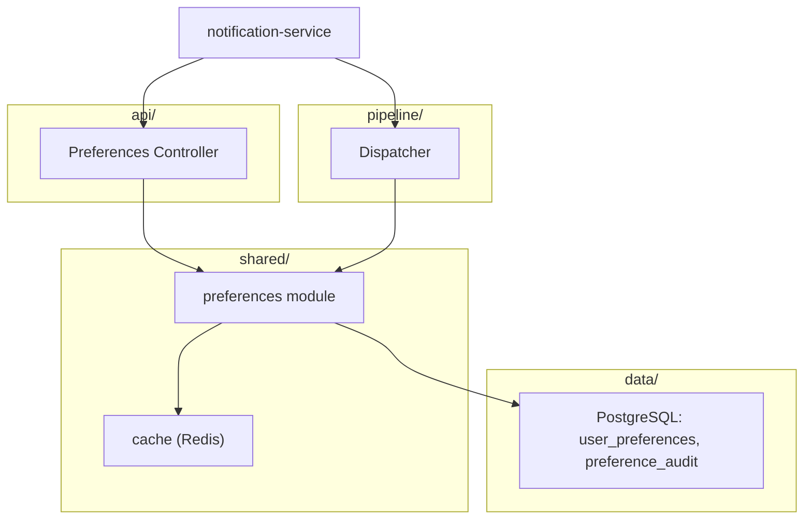
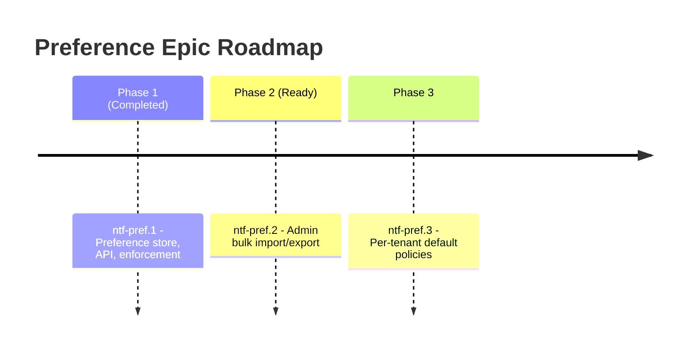

# Low Level Design: Per-User Notification Preference and Opt-Out (ntf-pref Epic)

- File Name: `ntf-pref_LLD.md`
- File Location: `notification-service/design/epic/`
- Related High Level Design: `design_example/epic_example/ntf_HLD.md`
- Related Feature Designs: `design_example/epic_example/features_example/ntf-pref.1_design_document.md` (Preference store, API, enforcement); `ntf-pref.2` (Admin bulk import/export); `ntf-pref.3` (Per-tenant default policies)
- Parent Epic / Beads Issue: `ntf-pref` (Notification Preferences & Compliance)
- Programming Languages: TypeScript, SQL
- Table of Contents: see section headings below

## Document Control

| Field | Value |
| :--- | :--- |
| Document Title | NTF – Per-User Notification Preference and Opt-Out LLD |
| Document Number / Name | NTF-PREF-LLD-001 |
| Version | LLD V1.0 |
| Design Status | Approved v1.0 |
| Date Created | 10/16/26 |
| Date Last Updated | 10/22/26 |
| Document Owner | Alex Rivera (alex.rivera@example.com) |
| Technical Contact | Alex Rivera (alex.rivera@example.com) |
| Owning Department / Team | Platform Engineering |
| Source File Location | notification-service/design/epics/ |
| Retention | Current Year + 2 Years; Disposal: Delete |
| Export Classification | Internal |
| Required Approvers | Alex Rivera – Tech Lead – 10/20/26; Sam Okonkwo – Product Manager – 10/21/26 |
| Mandatory Reviewers | Priya Shah – QA Lead – 10/22/26 |
| Optional Reviewers | DevOps Team |

---

## 1. Header / Metadata

- **Title**: Per-User Notification Preference and Opt-Out Management
- **Epic ID**: `ntf-pref`
- **Parent High Level Design**: `design_example/epic_example/ntf_HLD.md` (§1.3 NTF-REQ-002, NTF-REQ-004)
- **Status**: Approved
- **Author**: Alex Rivera
- **Reviewers**: Sam Okonkwo, Priya Shah
- **Date Created**: 10/16/26
- **Date Last Updated**: 10/22/26
- **Target Languages / Runtimes**: TypeScript (Node.js 20 LTS)
- **Build Tool / Version**: pnpm 9.x, Turborepo
- **Framework Stack**: Fastify 4, Prisma 5, PostgreSQL 16, Redis 7
- **Affected Modules / Components**: `shared/preferences`, `api/preferences`, `pipeline/dispatcher`
- **Child Feature Designs**: `ntf-pref.1_design_document.md` (Completed); `ntf-pref.2` (Ready); `ntf-pref.3` (Planned)
- **Child Bug Designs**: `ntf-bug-7_bug_design.md` (Fixed)

---

## 2. Executive Summary

This epic delivers per-user notification preference and opt-out management for the Real-Time Notification Service, satisfying **NTF-REQ-002** (user opt-out and channel preference management for GDPR/CCPA) and supporting **NTF-REQ-004** (audit trail of notification attempts).

Today, notification channel selection is hard-coded per template with no user-level override. Users cannot disable marketing emails while keeping transactional emails, and there is no recorded consent/opt-out history. This creates compliance risk and poor UX.

`ntf-pref` decomposes into three child features:
1. **`ntf-pref.1`** — Preference store, self-service API, and dispatch enforcement (Completed).
2. **`ntf-pref.2`** — Admin bulk import/export of preferences (Ready).
3. **`ntf-pref.3`** — Per-tenant default policies (Planned, phase 3).

The epic establishes a shared preference model, a cache-aware repository, an enforcement point in the dispatch pipeline, and an immutable audit log, all consumed by every channel.

---

## 3. Scope & Decomposition

### 3.1 In Scope
- Per-user, per-channel, per-category opt-in/opt-out state.
- Self-service REST API for users to read/update/reset preferences.
- Internal gRPC service for the dispatcher to check preferences.
- Enforcement in the dispatch pipeline (drop + audit when opted out).
- Immutable audit log of preference changes.
- Redis cache with invalidation for low-latency dispatch checks.
- Admin bulk import/export (phase 2).
- Per-tenant default policies (phase 3).

### 3.2 Out of Scope
- Marketing consent capture UI beyond channel opt-in/out (handled by separate consent service).
- Cross-tenant preference sharing (single tenant per user).
- Real-time preference propagation to third-party providers (not required).

### 3.3 Epic → Feature Breakdown

| Feature ID | Title | HLD § | Status | Owner |
| :--- | :--- | :--- | :--- | :--- |
| `ntf-pref.1` | Preference store, API, enforcement | §1.3 (NTF-REQ-002, NTF-REQ-004) | Completed | Alex Rivera |
| `ntf-pref.2` | Admin bulk import/export | §1.3 (NTF-REQ-002) | Ready | Alex Rivera |
| `ntf-pref.3` | Per-tenant default policies | §1.3 (NTF-REQ-002) | Planned | Alex Rivera |

### 3.4 Dependencies Between Features
- `ntf-pref.2` → `ntf-pref.1`: reuses `PreferenceRepository` and audit log.
- `ntf-pref.3` → `ntf-pref.1`: extends default-seeding logic introduced in `ntf-pref.1`.

### 3.5 Traceability to HLD

| HLD § / Requirement | Epic Coverage | Child Feature |
| :--- | :--- | :--- |
| NTF-REQ-002 (opt-out & channel prefs) | Full coverage | `ntf-pref.1`, `ntf-pref.2`, `ntf-pref.3` |
| NTF-REQ-004 (audit trail) | Preference audit log | `ntf-pref.1` |
| ntf_hld §3.6 (security, PII) | User-scoped access, encrypted storage | `ntf-pref.1` |
| ntf_hld §3.5 (performance SLO) | Cache hit p99 < 20ms | `ntf-pref.1` |

---

## 4. Target Architecture & Project Structure

### 4.1 Module / Component Hierarchy



### 4.2 Filesystem Layout

```
notification-service/
├── src/
│   ├── api/preferences/          # REST handlers
│   ├── shared/preferences/       # domain logic + repository
│   ├── pipeline/dispatcher/      # consumes preference checks
│   └── config/
├── migrations/
│   └── 0003_user_preferences.sql
├── tests/
│   ├── preferences.api.test.ts
│   └── preferences.dispatcher.test.ts
└── ...
```

### 4.3 Module / Component Responsibilities

#### `shared/preferences`
- **Purpose**: Domain logic, repository, cache, audit logging.
- **Stack**: Prisma, Redis (ioredis).
- **Child Features Touching It**: `ntf-pref.1`, `ntf-pref.2`, `ntf-pref.3`.
- **Follow-ups**: `ntf-pref.2` (admin bulk import), `ntf-pref.3` (tenant defaults).

#### `api/preferences`
- **Purpose**: REST endpoints for user self-service.
- **Stack**: Fastify, Zod validation.
- **Child Features Touching It**: `ntf-pref.1`.

#### `pipeline/dispatcher`
- **Purpose**: Enforces preferences before delivery; emits audit on drop.
- **Child Features Touching It**: `ntf-pref.1`.

### 4.4 Design Patterns Used

#### Repository
> **Pattern**:
> ```mermaid
> classDiagram
>     class PreferenceRepository { <<interface>> +find(userId) +save(p) }
>     class PostgresPreferenceRepository
>     PreferenceRepository <|.. PostgresPreferenceRepository
> ```
> **Why Chosen**: Abstracts data access for preferences/audit, enabling caching and test doubles.

#### Cache-Aside
> **Pattern**:
> ```mermaid
> flowchart LR
>     App --> Cache[(Redis)]
>     Cache -- miss --> DB[(PostgreSQL)]
>     DB --> Cache
> ```
> **Why Chosen**: Keeps dispatch latency low (target >95% hit rate) while preserving consistency via invalidation on write.

#### Strategy
> **Pattern**:
> ```mermaid
> classDiagram
>     class PreferenceCheck { <<interface>> +check(userId, channel, category) }
>     class CachedPreferenceCheck
>     PreferenceCheck <|.. CachedPreferenceCheck
> ```
> **Why Chosen**: Allows swapping between cached and direct DB checks for testing and fallback.

---

## 5. Build & Convention Strategy

### 5.1 Centralized Dependency Management

| Dependency Set | Version Coordinate | Scope |
| :--- | :--- | :--- |
| Fastify | `fastify@4` | service |
| Prisma | `@prisma/client@5` | shared/preferences |
| ioredis | `ioredis@5` | shared/preferences |

### 5.2 Module / Project Configuration Rules
- `shared/preferences` is a reusable library consumed by `api/preferences` and `pipeline/dispatcher`.
- Migrations live in `migrations/` and run via init container.
- Tests run per module with shared Testcontainers base config.

### 5.3 Executable vs. Library Modules
- `notification-service` is the deployable service; `shared/preferences` is a library (not independently deployable).

---

## 6. Detailed Design

### 6.1 Interfaces / APIs / Callable Services

**User-facing REST** (owner: `ntf-pref.1`)
- `GET /v1/preferences` → `{ channels: { push, email, inApp }, categories: { marketing, transactional, security } }`
- `PUT /v1/preferences` → body `{ channel?, category?, enabled }` → `200 { updated }`
- `DELETE /v1/preferences` → resets to defaults (opt-in all transactional/security, opt-out marketing).

**Internal gRPC** (owner: `ntf-pref.1`)
- `PreferenceService.Check(userId, channel, category) → { allowed: bool }`
- `PreferenceService.BulkCheck(userId, [channel,category]) → { results }`

**Events**
- `preference.changed` published to Kafka for downstream consumers (analytics).

### 6.2 Data Model / Schema

```sql
CREATE TABLE user_preferences (
  user_id       UUID NOT NULL,
  channel       TEXT NOT NULL,   -- push | email | inapp
  category      TEXT NOT NULL,   -- marketing | transactional | security
  enabled       BOOLEAN NOT NULL DEFAULT true,
  updated_at    TIMESTAMPTZ NOT NULL DEFAULT now(),
  updated_by    TEXT NOT NULL,   -- user | admin | system
  PRIMARY KEY (user_id, channel, category)
);

CREATE TABLE preference_audit (
  id            BIGSERIAL PRIMARY KEY,
  user_id       UUID NOT NULL,
  channel       TEXT NOT NULL,
  category      TEXT NOT NULL,
  old_value     BOOLEAN,
  new_value     BOOLEAN NOT NULL,
  changed_by    TEXT NOT NULL,
  reason        TEXT,
  created_at    TIMESTAMPTZ NOT NULL DEFAULT now()
);
```

Defaults: transactional + security channels default enabled; marketing defaults disabled (opt-in). Security-category notifications cannot be disabled (forced enabled).

### 6.3 Internal (Cross-Component) Interfaces
- `shared/preferences` exposes `PreferenceRepository` and `PreferenceCache`.
- Dispatcher calls `PreferenceService.Check` (gRPC) or in-process `PreferenceRepository.check` depending on deployment mode.

### 6.4 Error Handling Strategy
- Invalid channel/category → `400 INVALID_PREFERENCE` (ntf_hld §4.5 `NTF-001`).
- User not found → `404 USER_NOT_FOUND` (ntf_hld §4.5 `NTF-002`).
- Channel disabled by preference → drop + audit (ntf_hld §4.5 `NTF-003`).
- Cache miss → fall back to DB; repopulate.
- Audit write failure → log error, do not block preference update (audit is best-effort but retried async).

### 6.5 Serialization / Persistence of Resources
- Preferences stored in PostgreSQL; cache in Redis with 60s TTL.
- Cache invalidation on write (delete key) for immediate consistency.
- Two cache key schemes (single + bulk) — unified invalidation via `invalidateUser(userId)` (see `ntf-bug-7`).

### 6.6 Security Considerations
- Users may only read/write their own preferences (JWT `sub` == `userId`); admins may act on behalf (audited).
- Marketing opt-out is irreversible via API except by explicit user opt-in (GDPR).
- Security-category notifications cannot be disabled by users (forced enabled).
- All changes audited with actor and reason.
- PII (user IDs, preferences) encrypted at rest (Postgres TDE) and in transit (TLS).

### 6.7 Performance Considerations
- **Latency SLO**: preference check p99 < 20ms (cache hit), < 80ms (cache miss).
- **Throughput**: 5k checks/sec per instance.
- **Scalability**: horizontal scaling of API + dispatcher; Redis cluster for cache.
- Cache hit rate target > 95%; DB query only on miss.
- Bulk check for multi-channel dispatch to avoid N round trips.

### 6.8 Observability / Health Checks
- Metrics: `preference_check_total{channel,category,result}`, `preference_update_total`.
- Logs: structured with userId, channel, category, actor.
- Health: `/healthz`, `/readyz` (includes Redis/Postgres connectivity).

### 6.9 Alternatives Considered
- **In-memory cache instead of Redis**: rejected — does not share state across instances, causing inconsistent opt-out enforcement.
- **Synchronous audit writes blocking the request**: rejected — increases latency; audit is best-effort with async retry.
- **Single cache key scheme**: considered; deferred (see `ntf-bug-7` open question).

### 6.10 Rollback / Feature Flag Plan
- **Feature Flag**: `ntf.preferences.enforce` (owner: Alex Rivera).
- **Reversibility**: flag disables enforcement; preferences data remains intact.
- **Data Migration Rollback**: migration is additive (new tables only); rollback drops tables if needed.

---

## 7. Quality Assurance & Verification

### 7.1 Quality Gates Executed

```bash
# Lint + typecheck
pnpm lint && pnpm typecheck

# Unit tests
pnpm test --filter=preferences

# Integration tests (Testcontainers)
pnpm test:integration --filter=preferences
```

### 7.2 Test Matrix

| Module / Component | Build Status | Test Count | Test Pass Rate |
| :--- | :--- | :--- | :--- |
| `shared/preferences` | Pass | 20 | 100% (20/20) |
| `api/preferences` | Pass | 12 | 100% (12/12) |
| `pipeline/dispatcher` | Pass | 9 | 100% (9/9) |

### 7.3 Test Plan Reference
- Related Test Plan: `design_example/epic_example/ntf_TEST_PLAN.md`
- Related Test Cases: `ntf-pref.1_test_cases.md` (per child feature)

### 7.4 Notes / Baseline Adjustments
- Preference cache TTL chosen at 60s; tests use a mock Redis to validate invalidation. Security-category forced-enabled case covered by dedicated test.
- Bulk-invalidation regression test added for `ntf-bug-7`.

---

## 8. Migration, Coexistence & Rollout

### 8.1 Migration Considerations
- Producers migrate from synchronous send to publishing `NotificationRequested` events; dual-write for 2 weeks.
- Preference data seeded at registration (or computed on first read).
- Migration is additive (new tables only).

### 8.2 Coexistence Considerations
- Legacy and new paths coexist via feature flag per producer.
- Shared preference store ensures consistent opt-out behavior across both paths.

### 8.3 Rollout Plan
- Phase 1: `ntf-pref.1` behind `ntf.preferences.enforce` flag in staging, then prod.
- Phase 2: `ntf-pref.2` admin tooling.
- Phase 3: `ntf-pref.3` tenant defaults.

---

## 9. Risks, Assumptions & Open Questions

### 9.1 Risks
- Cache staleness could allow a notification to be sent after opt-out within the TTL window; mitigated by invalidation on write (residual risk only for cross-instance races, handled by short TTL). See `ntf-bug-7`.
- Cross-instance races: another instance may hold a stale bulk key; 60s TTL bounds residual risk.

### 9.2 Assumptions
- All users have a default preference row seeded at registration (or computed on first read).
- Marketing opt-in default is false globally (per-tenant override deferred to `ntf-pref.3`).

### 9.3 Open Questions
- Should marketing opt-in default be false globally or per-tenant? (Owner: Sam Okonkwo, due 10/30/26.)
- Should we unify to a single cache key scheme? (Owner: Alex Rivera, due 11/05/26.)

---

## 10. Migration Roadmap & Next Steps



### Key Decisions for Review

1. **Cache TTL 60s**: Balances dispatch latency and consistency; invalidation on write ensures immediate effect for self-service changes.
2. **Security category non-disableable**: Compliance requirement; cannot be overridden even by admins without a documented exception process (phase 2).
3. **Two cache key schemes**: accepted for now; unification deferred (see `ntf-bug-7`).

---

## 11. Changelog / Revision History

| Version | Date | Author | Summary of Changes |
| :--- | :--- | :--- | :--- |
| 0.1 | 10/16/26 | Alex Rivera | Initial draft |
| 1.0 | 10/22/26 | Alex Rivera | Approved after review |