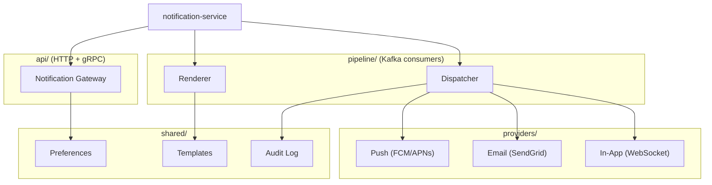

# High Level Design: Real-Time Notification Service (NTF)

- File Name: `ntf_hld.md`
- File Location: `notification-service/design/`
- Programming Languages: TypeScript, SQL
- Related Low Level Designs: `ntf-pref_LLD.md` (under `design_example/epic_example/`)
- Table of Contents

## Document Control

| Field | Value |
| :--- | :--- |
| Document Title | NTF – Real-Time Notification Service HLD |
| Document Number / Name | NTF-001 |
| Version | HLD V1.0 |
| Design Status | Approved v1.0 |
| Latest Change Date | 10/22/26 |
| Original Creation Date | 10/15/26 |
| Document Owner | Alex Rivera (alex.rivera@example.com) |
| Owner's Department / Location | Platform Engineering / Remote |
| Export Classification | Internal |
| Document Retention | Current Year + 5 Years; Disposal: Archive |
| Required Approvers | Alex Rivera – Tech Lead – 10/20/26; Sam Okonkwo – Product Manager – 10/21/26 |
| Stakeholders | Platform Engineering – Engineering – alex.rivera@example.com; QA – Quality – qa@example.com |

---

## 1. Introduction and Objectives
### 1.1 Design Overview
The Real-Time Notification Service (NTF) delivers push, email, and in-app notifications to users across web and mobile clients. Today, notifications are sent synchronously from each business service, causing latency spikes and dropped messages during traffic bursts. NTF centralizes notification delivery behind an asynchronous, event-driven pipeline.

Key deliverables:
- A single notification API and delivery pipeline for all channels (push, email, in-app).
- Decoupled producers via an event bus (Kafka) so business services never block on delivery.
- Per-user preference and opt-out management.
- Retry with exponential backoff and dead-letter handling for failed deliveries.
- Observability: delivery metrics, latency, and failure dashboards.

The service is optional for early adopters; legacy synchronous send paths remain available during migration.

### 1.2 Target Customer Environment
- Web and mobile clients (iOS/Android) in production and staging.
- Multi-tenant SaaS deployments; also usable in single-tenant enterprise installs.
- Benefits: application developers (simple API), platform/SRE (centralized delivery and observability), end users (reliable, preference-respecting notifications).

### 1.3 Customer and Business Needs Satisfied
- NTF-REQ-001: Reliable delivery of transactional notifications within 5s (p99) for push/in-app.
- NTF-REQ-002: User opt-out and channel preference management (GDPR/CCPA).
- NTF-REQ-003: Decouple notification sending from business request latency.
- NTF-REQ-004: Audit trail of all notification attempts for compliance.
Source: Product backlog items NTF-12, NTF-14, NTF-19; customer tickets CUST-441, CUST-502.

### 1.4 User Stories and Use Cases
- US-1: As a user, I receive order-confirmation push notifications within seconds of placing an order.
- US-2: As a user, I can disable marketing emails while keeping transactional emails.
- US-3: As a developer, I call one API to send a notification without managing delivery.
Use case: "Send transactional notification" — service publishes event → pipeline renders template → delivers via selected channels → records outcome.

### 1.5 Prerequisites, Corequisites, and Dependencies
- Kafka cluster (existing) for event ingestion.
- PostgreSQL (existing) for preferences, templates, and audit log.
- Redis (existing) for rate limiting and deduplication.
- Push providers: FCM (Android), APNs (iOS); email provider: SendGrid.
- Auth service for service-to-service JWT validation.
- Kubernetes cluster for deployment.

### 1.6 Delivery/Rollback Plan
- Target release: v1.0 in Q4 2026.
- Rollback: feature-flag gated; producers can revert to legacy synchronous path. Database migrations are backward-compatible (additive only). Rollback of the service itself is a standard deployment revert.

### 1.7 Exploiters (Consumers / Dependents)
- Order service, billing service, and auth service (first-party) will publish notification events.
- Optional exploitation: third-party integrations via webhook (phase 2).
- No updates required to mobile clients; they consume via existing push SDKs.

### 1.8 Components Affected and Sizing *(optional)*
| Component | Type of Impact | Sizing |
| :--- | :--- | :--- |
| notification-service (new) | New service | ~4 KLOC |
| order-service | Publish events | ~0.2 KLOC |
| billing-service | Publish events | ~0.2 KLOC |
| shared-events lib | New event schemas | ~0.5 KLOC |

### 1.9 Risks
- Kafka consumer lag during traffic spikes could delay delivery; mitigated by horizontal scaling and consumer group tuning.
- Provider rate limits (FCM/APNs/SendGrid) could throttle; mitigated by per-provider rate limiting and queuing.
- Template rendering errors could drop notifications; mitigated by validation at publish time and DLQ.

### 1.10 Vendor Product Considerations *(optional)*
- FCM, APNs, SendGrid terms permit transactional messaging. Marketing messages require separate consent flows (handled by preference service).

### 1.11 Intellectual Property
- No patentable innovations; uses standard open-source libraries (Apache 2.0 / MIT).

### 1.12 Bibliography
- NTF Product Requirements Doc (PRD-NTF-2026).
- Low Level Design: `ntf-pref_LLD.md` (per-user preference & opt-out epic).
- Event schema registry: `shared-events/README.md`.
- Provider docs: FCM, APNs, SendGrid.

---

## 2. Architecture Overview
### 2.1 Project Module Hierarchy


### 2.2 File System Layout
```
notification-service/
├── src/
│   ├── api/                 # HTTP/gRPC handlers
│   ├── pipeline/            # Kafka consumers (render, dispatch)
│   ├── providers/           # FCM, APNs, SendGrid, WebSocket
│   ├── shared/              # preferences, templates, audit
│   └── config/
├── migrations/              # DB migrations
├── k8s/                     # manifests
├── tests/
├── Dockerfile
└── package.json
```

### 2.3 Design Patterns Used

#### Event-Driven Architecture
> **Pattern**:
> ```mermaid
> flowchart LR
>     P[Producer] --> Broker[(Kafka)]
>     Broker --> C[Consumer]
> ```
> **Why Chosen**: Decouples notification producers from delivery, enabling retries, scaling, and replay. Rejected synchronous HTTP calls due to latency coupling.

#### Producer-Consumer
> **Pattern**:
> ```mermaid
> flowchart LR
>     P[Producer] --> Q[(Kafka Topic)]
>     Q --> C[Consumer]
> ```
> **Why Chosen**: Natural fit for Kafka; buffers bursts and smooths downstream provider rate limits.

#### Strategy
> **Pattern**:
> ```mermaid
> classDiagram
>     class Dispatcher { -strategy: ProviderStrategy +dispatch() }
>     class ProviderStrategy { <<interface>> +send() }
>     Dispatcher --> ProviderStrategy
> ```
> **Why Chosen**: Allows swapping push/email/in-app delivery implementations per channel without changing dispatch logic.

#### Repository
> **Pattern**:
> ```mermaid
> classDiagram
>     class PreferenceRepository { <<interface>> +find(userId) +save(p) }
>     class PostgresPreferenceRepository
>     PreferenceRepository <|.. PostgresPreferenceRepository
> ```
> **Why Chosen**: Abstracts data access for preferences/audit, enabling caching and test doubles.

#### Circuit Breaker
> **Pattern**:
> ```mermaid
> stateDiagram-v2
>     [*] --> Closed
>     Closed --> Open : failures
>     Open --> HalfOpen : timeout
>     HalfOpen --> Closed : success
> ```
> **Why Chosen**: Prevents cascading failures when a provider (FCM/APNs/SendGrid) is down; fails fast and recovers gracefully.

---

## 3. Impacts on Products Attributes
### 3.1 Installation Considerations
- Deploy via Helm chart to Kubernetes; requires Kafka/Postgres/Redis endpoints and provider API keys as secrets.
- Database migrations are additive; run via init container.
- Optional: configure per-environment provider credentials.

### 3.2 Reliability, Availability, and Serviceability Considerations
- Target 99.9% availability; horizontal scaling of consumers.
- Graceful shutdown drains in-flight messages.
- Health checks (liveness/readiness) on `/healthz`.

### 3.3 Migration Actions
- Producers migrate from synchronous send calls to publishing `NotificationRequested` events.
- Dual-write period: 2 weeks with both paths; then remove legacy.

### 3.4 Coexistence Considerations
- Legacy and new paths coexist via feature flag per producer.
- Shared preference store ensures consistent opt-out behavior across both paths.

### 3.5 Performance Considerations
- Push/in-app p99 < 5s; email < 60s.
- Kafka consumer throughput target: 10k events/sec.

### 3.6 Security Considerations
- Service-to-service auth via JWT; user data encrypted at rest (Postgres TDE) and in transit (TLS).
- PII (email, push tokens) stored encrypted; access logged.

### 3.7 Usability Considerations
- Developers use a single `sendNotification()` SDK method.
- Operators get dashboards for delivery rates and failures.

### 3.8 Accessibility Considerations
- In-app notifications follow ARIA live-region patterns; email templates are screen-reader friendly.

### 3.9 Testability Considerations
#### 3.9.1 Test Environment
- Local: Docker Compose (Kafka, Postgres, Redis, mock providers).
- CI: Testcontainers for integration tests.

#### 3.9.2 Test Scenarios
- Happy path: event → render → dispatch → audit.
- Preference opt-out blocks delivery.
- Provider failure → retry → DLQ.
- Rate limiting under burst.

#### 3.9.3 System Integrity Testing Considerations
- Contract tests between producers and the event schema.

#### 3.9.4 Performance Test Requirements
- Load test: 10k events/sec sustained; measure p99 latency and consumer lag.

#### 3.9.5 Regression Testing
- Golden-path tests for each channel; template rendering snapshots.

### 3.10 Globalization Considerations *(optional)*
- Templates support i18n via locale key; fallback to en-US.

### 3.11 Health Check Considerations
- `/healthz` (liveness), `/readyz` (readiness including Kafka/DB connectivity).

### 3.12 Common Criteria Considerations *(optional)*
- No security certification required for this service.

---

## 4. External Design
### 4.1 APIs, Callable Services, and Macros
- `POST /v1/notifications` — request body: `{ userId, templateId, channel[], params, priority }`.
- Response: `{ notificationId, status }`.
- gRPC: `NotificationService.Send(NotificationRequest)`.

### 4.2 Commands
- Admin CLI: `ntf-cli replay <notificationId>`, `ntf-cli dlq list`.

### 4.3 User Interfaces
- Preference management UI (web) for channel opt-in/out.

### 4.4 Environment Variables
- `KAFKA_BROKERS`, `DATABASE_URL`, `REDIS_URL`, `FCM_KEY`, `APNS_KEY`, `SENDGRID_KEY`, `JWT_PUBLIC_KEY`.

### 4.5 Codes
- `NTF-001` invalid template; `NTF-002` user not found; `NTF-003` channel disabled by preference.

### 4.6 Exits (System and User) *(optional)*
- None.

### 4.7 Diagnostic Aids
- Distributed tracing (OpenTelemetry), structured logs, metrics via Prometheus.

### 4.8 Messages
- Kafka topic `notification.requested` (New), `notification.delivered` (New), `notification.failed` (New).

### 4.9 Audit / Telemetry Records *(optional)*
- Audit table `notification_attempts` (id, user_id, template_id, channel, status, provider_response, created_at).

### 4.10 Health Checks
- `/healthz`, `/readyz`, `/metrics`.

### 4.11 Miscellaneous
#### 4.11.1 Tools
- `ntf-cli` admin tool; `notification-replayer` for DLQ.

#### 4.11.2 Databases
- Tables: `users_preferences`, `templates`, `notification_attempts`.

#### 4.11.3 Other *(optional)*
- WebSocket gateway for in-app delivery.

---

## 5. Internal Design
### 5.1 Rationale
Event-driven pipeline chosen over synchronous delivery to decouple producers from delivery latency and enable retries. Kafka provides durability and replay.

#### 5.1.1 Alternatives Considered
- Synchronous HTTP to providers: rejected due to latency coupling and no retry durability.
- RabbitMQ: rejected in favor of existing Kafka infrastructure.

#### 5.1.2 Follow-On / Future Work *(optional)*
- Phase 2: webhook delivery, A/B template testing, ML-based send-time optimization.

#### 5.1.3 Post-Review Design Changes *(optional)*
- Added deduplication layer (Redis) after review to prevent duplicate push on retry.

### 5.2 Internal (Cross-Component) Interfaces
- Event schema `NotificationRequested` (versioned in shared-events).
- Internal gRPC `PreferenceService`.

### 5.3 Serialization of Resources
- Distributed lock via Redis for per-user rate limiting (key: `ratelimit:{userId}`).

### 5.4 Error Handling Strategy
- Transient provider errors → retry with exponential backoff (max 5) → DLQ.
- Permanent errors (invalid token) → mark preference invalid, no retry.

### 5.5 Dynamic Service Update and Diagnosis
- Config (templates, provider endpoints) reloadable via config map without restart.

### 5.6 Advanced Customization
- Custom templates per tenant (phase 2).

---

## 6. Publication Updates *(optional)*
- Developer docs: new "Sending Notifications" guide.
- API reference: OpenAPI spec published to developer portal.

---

## 7. Appendix: Internal-Level Detail *(optional)*
> Distributed lock key format and TTL:
>
> ```
> ╔═════════════════════ INTERNAL LEVEL DETAIL ═════════════════════╗
> lock key: ratelimit:{userId}:{channel}, TTL 60s, max 10 req/min
> ╚═════════════════════ END INTERNAL LEVEL DETAIL ══════════════════╝
> ```
## Review Update Summary (auto-generated)
_Generated 2026-10-26T18:45:07.993033 by capture_all.py (--update-doc)_

The following AI models reviewed this HLD. See HLD_Review_Model_Test.md for full review results.

| Model | Role | Accuracy | Status |
|-------|------|----------|--------|
| qwen3.5:Architect | Solution Architect / Lead QA / Code Reviewer / Security Reviewer / Documentation | 100% | Reviewed |
| qwen2.5-coder:3b | Epic Owner / Tech Lead / Feature Designer / Senior QA / DevOps / Bugfix Designer / UI/UX | 100% | Reviewed |
| qwen2.5-coder:0.5b | QA / Test Engineer | 75% | Reviewed |
| qwen3:0.6b | QA / Test Engineer / Feature Implementer | 75% | Reviewed |
| gemma3:1b | QA / Test Engineer (UI/UX) / Feature Implementer | 100% | Reviewed |

---
