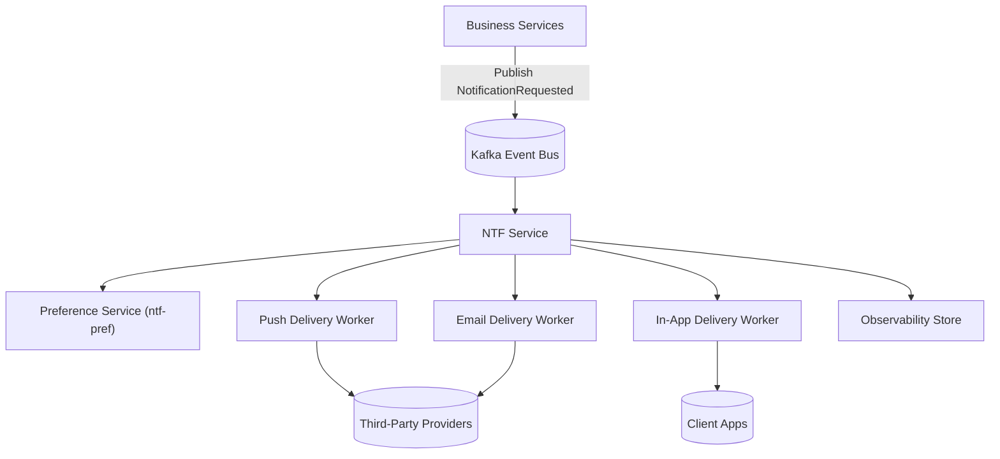

# Project Analysis: Real-Time Notification Service (NTF)

- File Name: `ntf_Project_Analysis.md`
- File Location: `notification-service/design/`
- Programming Languages: TypeScript, SQL
- Related High Level Design: `ntf_HLD.md` *(to be created after approval)*
- Related Low Level Designs: *(none yet)*
- Table of Contents

## Document Control

| Field | Value |
| :--- | :--- |
| Document Title | NTF – Project Analysis |
| Document Number / Name | NTF-PA-001 |
| Version | v1.0 |
| Analysis Status | Approved v1.0 |
| Latest Change Date | 10/14/26 |
| Original Creation Date | 10/08/26 |
| Document Owner | Alex Rivera (alex.rivera@example.com) |
| Owner's Department / Location | Platform Engineering / Remote |
| Export Classification | Internal |
| Document Retention | Current Year + 2 Years; Disposal: Archive |
| Required Approvers | Alex Rivera – Tech Lead – 10/12/26; Sam Okonkwo – Product Manager – 10/13/26 |
| Stakeholders | Platform Engineering – Engineering – alex.rivera@example.com; Product – Product Management – sam.okonkwo@example.com; QA – Quality – qa@example.com |
| Related Beads Issues | dev-ntf-pa-001 |

---

## 1. Executive Summary

### 1.1 Purpose

This project analysis evaluates the need for a centralized Real-Time Notification Service (NTF) to replace the current synchronous, per-service notification sending pattern. The analysis supports the Product Owner's decision on whether to proceed with building NTF, defer the initiative, pivot to an alternative, or decline.

### 1.2 Problem Statement

Today, each business service sends notifications (push, email, in-app) synchronously as part of request handling. This causes:

- **Latency spikes**: Notification delivery adds 200–800 ms to user-facing request times during traffic bursts.
- **Dropped messages**: When third-party email/push providers throttle or fail, notifications are silently lost because there is no retry or dead-letter queue.
- **No per-user preference management**: Users cannot opt out of individual notification channels; all channels are on by default.
- **No observability**: There is no centralized dashboard for delivery rates, latency, or failure analysis.

### 1.3 Recommended Direction

**Proceed** with building NTF as a centralized, event-driven notification pipeline. The recommendation is based on the high customer-visible impact of dropped notifications and latency, the availability of existing event-bus infrastructure (Kafka), and the clear separation of concerns between business services (producers) and notification delivery (consumer).

### 1.4 Key Deliverables

- A single notification API and delivery pipeline for all channels (push, email, in-app).
- Decoupled producers via an event bus so business services never block on delivery.
- Per-user preference and opt-out management (epic `ntf-pref`).
- Retry with exponential backoff and dead-letter handling for failed deliveries.
- Observability: delivery metrics, latency, and failure dashboards.

### 1.5 Success Criteria

- 99.9% of accepted notifications are delivered or dead-lettered within 5 minutes.
- P95 notification API latency < 50 ms (async enqueue only).
- Zero silently dropped notifications due to provider throttling.
- 100% of users can manage per-channel preferences via the preference service.

---

## 2. Stakeholders & Requirements

### 2.1 Stakeholder Register

| Stakeholder | Role | Function | Department | Contact | Interest / Concern |
| :--- | :--- | :--- | :--- | :--- | :--- |
| Alex Rivera | Tech Lead | Engineering | Platform Engineering | alex.rivera@example.com | Architecture, delivery reliability, operability |
| Sam Okonkwo | Product Manager | Product Management | Product | sam.okonkwo@example.com | Time to market, customer impact, cost |
| Priya Mehta | QA Lead | Quality | QA | priya.mehta@example.com | Delivery correctness, retry semantics, observability |
| Jordan Lee | Security Reviewer | Security | Security | jordan.lee@example.com | Data privacy, PII in notification payloads, access control |

### 2.2 Business Needs & Requirements

| Req ID | Requirement | Source | Priority | Acceptance Criteria |
| :--- | :--- | :--- | :--- | :--- |
| REQ-001 | Business services must not block on notification delivery | Sam Okonkwo | P1 | API returns 202 within 50 ms of enqueue |
| REQ-002 | Failed deliveries are retried with exponential backoff | Alex Rivera | P1 | Max 3 retries; dead-letter after exhaustion |
| REQ-003 | Users can opt out of individual notification channels | Priya Mehta | P1 | Preference service honors opt-out flags |
| REQ-004 | Notification payloads containing PII are encrypted at rest | Jordan Lee | P2 | Encryption at rest verified in staging |

### 2.3 Out of Scope

- Building a new email or push provider integration; NTF will use existing provider APIs.
- Real-time WebSocket delivery to clients; initial release is push/email/in-app REST only.
- Notification content authoring UI; content is passed by business services in the API payload.

---

## 3. Current State Assessment

### 3.1 Existing System / Process

Each business service (orders, payments, accounts) calls notification provider APIs directly within request handlers. There is no central queue, no retry logic, and no preference store. Event bus (Kafka) is already deployed for other domains.

### 3.2 Current Limitations

- Synchronous delivery blocks user-facing requests.
- No retry or dead-letter queue; provider failures lose messages.
- No centralized observability for delivery success/failure rates.
- No per-user channel preferences; all users receive all channels.

### 3.3 Baseline Metrics

| Metric | Current Value |
| :--- | :--- |
| Avg. notification-added latency per request | 200–800 ms |
| Estimated dropped notification rate | ~3% during provider throttling |
| P95 API latency for notification-calling endpoints | 1.2 s |

---

## 4. Options Analysis

### 4.1 Option A: Centralized Event-Driven Notification Service (Recommended / Baseline)

Build NTF as a standalone service consuming from Kafka, with per-channel delivery workers, retry/dead-letter logic, and a preference service integration.

| Criterion | Assessment | Notes |
| :--- | :--- | :--- |
| Fit to requirements | High | Covers all P1/P2 requirements |
| Effort (person-weeks) | 16 | 4 engineers × 4 weeks |
| Risk | Medium | New service to operate; existing Kafka reduces integration risk |
| Cost | $18K | Compute + managed Kafka topics |
| Timeline | 6 weeks | Including staging and observability |
| Dependencies | Kafka (existing), preference service (epic `ntf-pref`) | Preference service can follow in parallel |
| Rollback feasibility | Yes | Legacy synchronous paths remain during migration |

### 4.2 Option B: Per-Service Async Queues (Sidecar Pattern)

Each business service runs its own local notification queue and delivery worker.

| Criterion | Assessment | Notes |
| :--- | :--- | :--- |
| Fit to requirements | Medium | Duplicates retry/observability logic across services |
| Effort (person-weeks) | 24 | 3 services × 8 weeks |
| Risk | High | Operational sprawl; inconsistent retry semantics |
| Cost | $30K | More compute, duplicated effort |
| Timeline | 10 weeks | Per-service rollout |
| Dependencies | None new | |
| Rollback feasibility | Partial | Each service must roll back independently |

### 4.3 Option C: Buy a Managed Notification SaaS *(optional)*

Purchase a third-party notification platform (e.g., SendGrid + OneSignal managed tiers) and integrate via webhooks.

| Criterion | Assessment | Notes |
| :--- | :--- | :--- |
| Fit to requirements | Low | No per-user preference store; limited retry control |
| Effort (person-weeks) | 8 | Integration only |
| Risk | High | Vendor lock-in; PII leaves our environment |
| Cost | $50K/yr | Ongoing SaaS fees |
| Timeline | 4 weeks | Fastest to integrate |
| Dependencies | Vendor contracts, security review | |
| Rollback feasibility | Yes | Can revert to synchronous per-service calls |

### 4.4 Decision Matrix & Rationale

**Selected: Option A** — Centralized Event-Driven Notification Service.

Rationale: Option A best satisfies all P1 requirements (async enqueue, retry/dead-letter, preference management) with the lowest operational risk because it reuses existing Kafka infrastructure and centralizes delivery logic. Option B duplicates effort and creates operational sprawl. Option C fails on preference management and raises PII/data-residency concerns. The decision to proceed is gated on the preference service epic (`ntf-pref`) being scoped in parallel.

---

## 5. Technical Design Considerations

### 5.1 High-Level Architecture

Business services publish `NotificationRequested` events to Kafka. NTF consumes these events, enriches with user preferences, routes to channel-specific delivery workers (push, email, in-app), and writes delivery outcomes to an observability store.

### 5.2 Components Affected

| Component | Impact | Est. Size | Owner |
| :--- | :--- | :--- | :--- |
| NTF Service | New | 8 KLOC | Platform Engineering |
| Preference Service | New (epic `ntf-pref`) | 5 KLOC | Platform Engineering |
| Business Services | Modified (publish events) | 2 KLOC each | Service Teams |
| Kafka | Existing (new topics) | — | Platform Engineering |

### 5.3 Non-Functional Requirements

| NFR | Target | Measurement Method | Owner |
| :--- | :--- | :--- | :--- |
| Performance / Latency | P95 < 50 ms enqueue | API latency histogram | Platform Engineering |
| Availability / SLO | 99.9% delivery | Delivery success SLO | Platform Engineering |
| Scalability | 10K msgs/sec | Kafka consumer lag | Platform Engineering |
| Security | PII encrypted at rest | Encryption verification | Security Reviewer |
| Compliance | GDPR opt-out honored | Preference flag audit | QA Lead |
| Operability | Delivery dashboard | Grafana dashboards | Platform Engineering |

### 5.4 Risks & Mitigations

| Risk | Likelihood | Impact | Mitigation | Owner |
| :--- | :--- | :--- | :--- | :--- |
| Provider throttling causes backlog | Medium | High | Exponential backoff + dead-letter queue | Platform Engineering |
| Preference service not ready at NTF launch | Medium | Medium | Launch NTF with default-on preferences; integrate pref service in v1.1 | Product Manager |
| PII in notification payloads | Low | High | Encrypt at rest; field-level masking in logs | Security Reviewer |

### 5.5 Dependencies & Prerequisites

- Kafka event bus (existing, no new infrastructure).
- Preference service epic (`ntf-pref`) scoped for parallel delivery.
- Business services instrumented to publish `NotificationRequested` events.

---

## 6. Rollout & Rollout Plan

### 6.1 Rollout Approach

Phased rollout behind feature flags:
1. **Phase 1**: NTF in staging with in-app channel only.
2. **Phase 2**: Enable email and push channels in staging; run parallel with legacy synchronous paths.
3. **Phase 3**: Cut over production traffic to NTF; legacy paths retained for rollback.
4. **Phase 4**: Decommission legacy synchronous notification code after 30 days of clean metrics.

### 6.2 Rollback Plan

- **Trigger**: Delivery success rate < 99% or P95 enqueue latency > 100 ms for 15 consecutive minutes.
- **Steps**: Flip feature flag to route notifications back to legacy synchronous paths; drain NTF queue; investigate and remediate.
- **Data migration**: None required; no user data is migrated by NTF.

### 6.3 Communication Plan

- Stakeholder notification at each phase gate via email and Slack #platform-alerts.
- Internal runbook published to the engineering wiki before production cutover.
- Customer-facing change log updated when preference opt-out becomes available.

---

## 7. Resource & Effort Estimate

| Activity | Owner | Est. Effort | Target Dates |
| :--- | :--- | :--- | :--- |
| NTF service implementation | Platform Engineering | 8 person-weeks | 10/19/26 – 11/13/26 |
| Preference service (epic `ntf-pref`) | Platform Engineering | 5 person-weeks | 10/19/26 – 10/30/26 |
| Business service event instrumentation | Service Teams | 6 person-weeks | 10/26/26 – 11/06/26 |
| Staging validation and observability | QA Lead | 3 person-weeks | 11/09/26 – 11/13/26 |
| Production cutover and rollback drill | Platform Engineering | 2 person-weeks | 11/16/26 – 11/20/26 |

### 7.1 Total Estimated Effort

24 person-weeks

### 7.2 Required Skillsets

Solution Architect, Lead QA, DevOps / Release Engineer, Security Reviewer, Platform Engineering.

---

## 8. Decision & Approval

### 8.1 Decision

Proceed with Option A (Centralized Event-Driven Notification Service). Conditions: preference service epic `ntf-pref` must be scoped and staffed in parallel; security review of PII handling must pass before production cutover.

### 8.2 Approval Sign-off

| Approver | Role | Date | Decision |
| :--- | :--- | :--- | :--- |
| Alex Rivera | Tech Lead | 2026-10-12 | Approved |
| Sam Okonkwo | Product Manager | 2026-10-13 | Approved |

### 8.3 Conditions of Approval *(if applicable)*

- Security reviewer sign-off on PII handling before production cutover.
- Preference service epic `ntf-pref` staffed and kicked off by 10/19/26.

---

## 9. Follow-Up Actions

| Action | Owner | Due Date | Status |
| :--- | :--- | :--- | :--- |
| Draft HLD (`ntf_HLD.md`) | Solution Architect | 2026-10-19 | Open |
| Scope preference service epic (`ntf-pref`) | Product Manager | 2026-10-16 | Open |
| Schedule security review of PII handling | Security Reviewer | 2026-10-16 | Open |

---

## 10. Changelog / Revision History

| Version | Date | Author | Summary of Changes |
| :--- | :--- | :--- | :--- |
| 0.1 | 2026-10-08 | Alex Rivera | Initial draft |
| 1.0 | 2026-10-14 | Alex Rivera | Approved after Product Owner decision to proceed |
