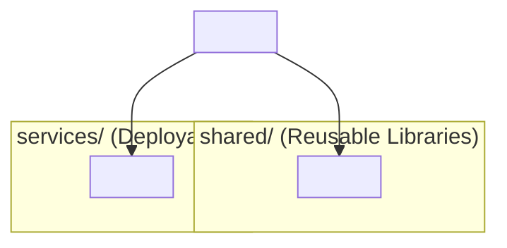
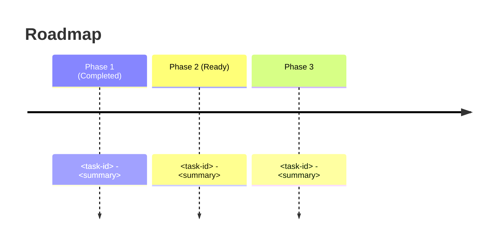

# Feature Design Template

- File Name: `<Feature or Task ID>_design_document.md` (e.g. `api-ouw.1_design_document.md`)
- File Location: `<Project Directory>/design/epic/features/`
- Related High Level Design: `<Project Acronym>_HLD.md`
- Related Low Level Design: `<Epic ID>_LLD.md` (under `design/epic/`)
- Implements HLD Section: <§ reference, e.g. §2.3>
- Related Beads Issue / Epic: `<issue-id>` / `<parent-epic-id>`
- Programming Languages: <List of languages>
- Table of Contents: see section headings below

> **How to use this template:** Replace every `<...>` placeholder with project-specific content. Keep section headings and numbering consistent so reviewers can compare across features. Sections marked *(optional)* may be omitted when not applicable, but justify the omission in the PR description. Adapt build/layout examples to your stack.

## Document Control *(optional — recommended for larger features)*

| Field | Value |
| :--- | :--- |
| Version | <e.g. v0.1> |
| Design Status | Draft \| In Review \| Reviewed \| Approved \| Draft v<x.x> \| In Review v<x.x> \| Reviewed v<x.x> \| Approved v<x.x> |
| Date Created | <YYYY-MM-DD> |
| Date Last Updated | <YYYY-MM-DD> |
| Author | <name> (<email>) |
| Reviewers | <names> |
| Required Approvers | <name – role – date> |

---

## 1. Header / Metadata

- **Title**: <Short, descriptive feature title>
- **Task ID**: `<project>-<epic>.<n>` (e.g. `api-ouw.1`)
- **Parent Epic**: `<epic-id>` (<Epic title>)
- **Status**: Draft | In Review | Approved | In Progress | Completed | Ready for Review
- **Author**: <name>
- **Reviewers**: <names>
- **Date Created**: <YYYY-MM-DD>
- **Date Last Updated**: <YYYY-MM-DD>
- **Target Languages / Runtimes**: <e.g. Java 21 (LTS), Node.js 20, Python 3.12>
- **Build Tool / Version**: <e.g. Gradle 9.5, pnpm 9, cargo 1.78>
- **Framework Stack**: <e.g. Spring Boot 4.1, Fastify 4, Django 5>
- **Affected Modules / Components**: <list>

---

## 2. Executive Summary

<2-4 paragraphs describing the problem, the change, and the intended outcome. Include a numbered list of the key deliverables this feature establishes.>

1. <Deliverable 1>
2. <Deliverable 2>
3. <Deliverable 3>

---

## 3. Target Architecture & Project Structure

### 3.1 Module / Component Hierarchy



### 3.2 Filesystem Layout

```
<project-root>/
├── <top-level files>          # adapt to your stack (package.json, pyproject.toml, pom.xml, Cargo.toml)
├── src/                       # or app/, lib/
│   ├── <module>/
│   │   └── ...
│   └── ...
├── tests/
└── ...
```

### 3.3 Module / Component Responsibilities *(optional)*

#### `<module-name>` (Port `<port>` if applicable)
- **Purpose**: <what it does>
- **Stack**: <frameworks, libraries>
- **Next Phase / Follow-ups**: <linked tasks>

### 3.4 Design Patterns Used *(optional)*
> For each pattern applied in this feature, provide:
> - **Pattern Name**: <e.g. Repository, Strategy, Observer>
> - **Pattern**: <Mermaid diagram or reference to `*_patterns*.md`>
> - **Why Chosen**: <rationale — problem addressed, trade-offs, alternatives rejected>

#### 3.4.1 <Pattern Name>
> **Pattern**: <Mermaid diagram>
> **Why Chosen**: <rationale>

---

## 4. Build & Convention Strategy *(optional — include for build/infra features)*

### 4.1 Centralized Dependency Management *(optional)*
> List dependencies and versions per your stack (e.g. Maven/Gradle BOMs, npm/pnpm, pip/uv, cargo).

| Dependency Set | Version Coordinate | Scope |
| :--- | :--- | :--- |
| <Dependency Set> | `<coordinate>` | <global / module> |

### 4.2 Module / Project Configuration Rules *(optional)*
- <Rule 1, e.g. shared libs are published as packages; services are deployable units>
- <Rule 2, e.g. tests run per module with shared base config>

### 4.3 Executable vs. Library Modules *(optional)*
> Distinguish deployable services from reusable libraries (e.g. Spring Boot jar vs. java-library; FastAPI app vs. shared package).

---

## 5. Detailed Design

### 5.1 Interfaces / APIs / Callable Services
- **Endpoint / Method**: `<HTTP method> <path>` or `<function signature>`
- **Request**: <schema / parameters>
- **Response**: <schema / envelope>
- **Errors**: <error codes and handling>

### 5.2 Data Model / Schema *(optional)*
- **Entities / Tables**: <name, fields, relationships>
- **Migrations**: <migration scripts or tooling>

### 5.3 Internal (Cross-Component) Interfaces
- <interface name>: <contract summary>

### 5.4 Error Handling Strategy
- <How errors are detected, propagated, logged, and surfaced to users>

### 5.5 Serialization / Persistence of Resources *(optional)*
- <Formats, storage locations, retention>

### 5.6 Security Considerations
- <Auth, authorization, secrets, input validation, threat notes>

### 5.7 Performance Considerations *(optional)*
- **Latency SLO**: <e.g. p99 < 200ms>
- **Throughput**: <e.g. 1k req/s>
- **Scalability**: <horizontal/vertical, caching, sharding>

### 5.8 Observability / Health Checks *(optional)*
- <Metrics, logs, traces, health endpoints, alerts>

### 5.9 Alternatives Considered *(optional)*
- <Alternative>: <why rejected>

### 5.10 Rollback / Feature Flag Plan *(optional)*
- **Feature Flag**: <name and owner>
- **Reversibility**: <can the change be reverted; migration rollback steps>
- **Data Migration Rollback**: <how data is restored if needed>

---

## 6. Quality Assurance & Verification

### 6.1 Quality Gates Executed

```bash
# <gate 1 description>
<command 1>

# <gate 2 description>
<command 2>
```

### 6.2 Test Matrix

| Module / Component | Build Status | Test Count | Test Pass Rate |
| :--- | :--- | :--- | :--- |
| `<module>` | `Pass` / `Fail` | <n> | <n>/<n> |

### 6.3 Notes / Baseline Adjustments

> <Any test or config changes required to establish the baseline, e.g. container imports, flaky-test handling.>

---

## 7. Migration Roadmap & Next Steps *(optional)*



### Key Decisions for Review

1. **<Decision title>**: <rationale and implications>
2. **<Decision title>**: <rationale and implications>

---

## 8. Risks, Assumptions & Open Questions

### 8.1 Risks
- <risk and mitigation>

### 8.2 Assumptions
- <assumption>

### 8.3 Open Questions
- <question and owner>

---

## 9. Reviewed by and Comments

### 9.1 Reviewers

| Reviewer | Role | Date | Comments |
| :--- | :--- | :--- | :--- |
| <name> | <role> | <YYYY-MM-DD> | <comments> |

### 9.2 Comment Section

- **File location**: `<Project Acronym>_<File Being Reviewed>_Comments.md`
- **Created Date**: `<YYYY-MM-DD>`
- **Modified Date**: `<YYYY-MM-DD>`

---

## 10. Changelog / Revision History

| Version | Date | Author | Summary of Changes |
| :--- | :--- | :--- | :--- |
| 0.1 | <YYYY-MM-DD> | <name> | Initial draft |