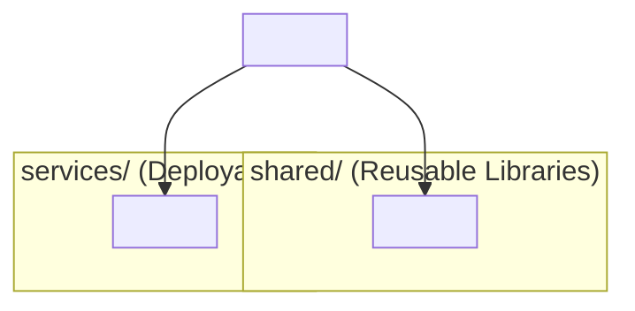
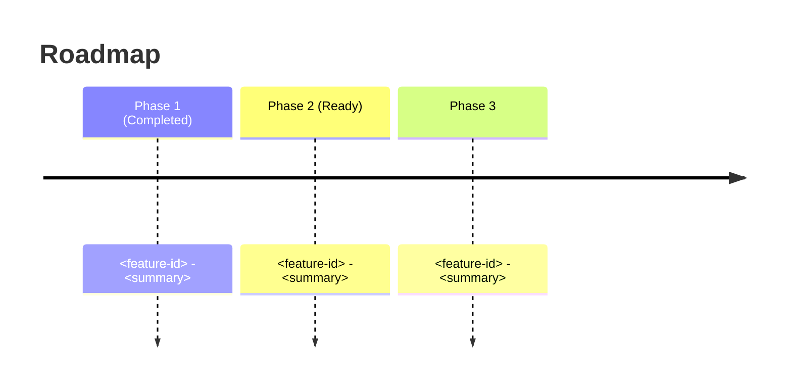

# Low Level Design Template

- File Name: `<Project Acronym>_<Epic ID>_LLD.md` (e.g. `ntf-pref_LLD.md`) — see `design_example/epic_example/ntf-pref_LLD.md`
- File Location: `<Project Directory>/design/epic/` (alongside its `features/` and `bugs/` subfolders)
- Related High Level Design: `<Project Acronym>_HLD.md`
- Related Feature Designs: `<Feature ID>_design_document.md` (one per child feature)
- Parent Epic / Beads Issue: `<epic-id>`
- Programming Languages: <List of languages>
- Table of Contents: see section headings below

> **How to use this template:** Replace every `<...>` placeholder with project-specific content. The LLD sits between the HLD (project/line-item level) and Feature Design (per feature/bug): it decomposes an epic into its constituent features and pins down the detailed technical design shared across them. Keep section headings and numbering consistent so reviewers can compare across epics. Sections marked *(optional)* may be omitted when not applicable, but justify the omission in the PR description. Fill in through constant User–AI communication, section by section, confirming each section before proceeding.

## Document Control *(recommended — required for larger epics)*

| Field | Value |
| :--- | :--- |
| Document Title | `<Project Acronym>` – <Epic Name> Low Level Design |
| Document Number / Name | <entry in project database> |
| Version | <e.g. LLD V1.0> |
| Design Status | Draft \| In Review \| Reviewed \| Approved \| Draft v<x.x> \| In Review v<x.x> \| Reviewed v<x.x> \| Approved v<x.x> |
| Date Created | <YYYY-MM-DD> |
| Date Last Updated | <YYYY-MM-DD> |
| Document Owner | <name> (<email>) |
| Technical Contact | <name> (<email>) |
| Owning Department / Team | <team> |
| Source File Location | <path / repo> |
| Retention | <e.g. Current Year + 2 Years; Disposal: Delete> |
| Export Classification | <code> |
| Required Approvers | <name – role – email – date> |
| Mandatory Reviewers | <name – area – email – date> |
| Optional Reviewers | <name – area – email – date> |

---

## 1. Header / Metadata

- **Title**: <Short, descriptive epic title>
- **Epic ID**: `<project>-<epic>` (e.g. `ntf-pref`)
- **Parent High Level Design**: `<Project Acronym>_HLD.md` (§ reference, e.g. §1.3)
- **Status**: Draft | In Review | Approved | In Progress | Completed
- **Author**: <name>
- **Reviewers**: <names>
- **Date Created**: <YYYY-MM-DD>
- **Date Last Updated**: <YYYY-MM-DD>
- **Target Languages / Runtimes**: <e.g. TypeScript (Node.js 20 LTS)>
- **Build Tool / Version**: <e.g. pnpm 9.x, Turborepo>
- **Framework Stack**: <e.g. Fastify 4, Prisma 5, PostgreSQL 16, Redis 7>
- **Affected Modules / Components**: <list>
- **Child Feature Designs**: <list of `<Feature ID>_design_document.md`>
- **Child Bug Designs**: <list of `<Bug ID>_bug_design.md`>

---

## 2. Executive Summary

<2-4 paragraphs describing the epic, the problem it solves, the change, and the intended outcome. Include a numbered list of the key deliverables this epic establishes and how they decompose into child features.>

1. <Deliverable 1> → `<feature-id>`
2. <Deliverable 2> → `<feature-id>`
3. <Deliverable 3> → `<feature-id>`

---

## 3. Scope & Decomposition

### 3.1 In Scope
- <capability 1>
- <capability 2>

### 3.2 Out of Scope
- <explicitly excluded item> (rationale)

### 3.3 Epic → Feature Breakdown

| Feature ID | Title | HLD § | Status | Owner |
| :--- | :--- | :--- | :--- | :--- |
| `<feature-id>` | <title> | <§ ref> | Draft / In Progress / Done | <name> |

### 3.4 Dependencies Between Features
- `<feature-a>` → `<feature-b>`: <reason (e.g. shared schema, API contract)>

### 3.5 Traceability to HLD
| HLD § / Requirement | Epic Coverage | Child Feature |
| :--- | :--- | :--- |
| <§ number / REQ-ID> | <how the epic addresses it> | `<feature-id>` |

---

## 4. Target Architecture & Project Structure

### 4.1 Module / Component Hierarchy



### 4.2 Filesystem Layout

```
<project-root>/
├── <top-level files>          # adapt to your stack
├── src/
│   ├── <module>/
│   │   └── ...
│   └── ...
├── tests/
└── ...
```

### 4.3 Module / Component Responsibilities *(optional)*

#### `<module-name>` (Port `<port>` if applicable)
- **Purpose**: <what it does>
- **Stack**: <frameworks, libraries>
- **Child Features Touching It**: <list of feature IDs>
- **Follow-ups**: <linked tasks>

### 4.4 Design Patterns Used *(optional)*
> For each pattern applied in this epic, provide:
> - **Pattern Name**: <e.g. Repository, Strategy, Observer, Event-Driven>
> - **Pattern**: <Mermaid diagram or reference to `*_patterns*.md`>
> - **Why Chosen**: <rationale — problem addressed, trade-offs, alternatives rejected>

#### 4.4.1 <Pattern Name>
> **Pattern**: <Mermaid diagram>
> **Why Chosen**: <rationale>

---

## 5. Build & Convention Strategy *(optional — include for build/infra epics)*

### 5.1 Centralized Dependency Management *(optional)*

| Dependency Set | Version Coordinate | Scope |
| :--- | :--- | :--- |
| <Dependency Set> | `<coordinate>` | <global / module> |

### 5.2 Module / Project Configuration Rules *(optional)*
- <Rule 1, e.g. shared libs are published as packages; services are deployable units>
- <Rule 2, e.g. tests run per module with shared base config>

### 5.3 Executable vs. Library Modules *(optional)*
> Distinguish deployable services from reusable libraries (e.g. Spring Boot jar vs. java-library).

---

## 6. Detailed Design

### 6.1 Interfaces / APIs / Callable Services
- **Endpoint / Method**: `<HTTP method> <path>` or `<function signature>`
- **Request**: <schema / parameters>
- **Response**: <schema / envelope>
- **Errors**: <error codes and handling>
- **Owner Feature**: `<feature-id>`

### 6.2 Data Model / Schema *(optional)*
- **Entities / Tables**: <name, fields, relationships>
- **Migrations**: <migration scripts or tooling>
- **Owner Feature**: `<feature-id>`

### 6.3 Internal (Cross-Component) Interfaces
- <interface name>: <contract summary>

### 6.4 Error Handling Strategy
- <How errors are detected, propagated, logged, and surfaced to users>

### 6.5 Serialization / Persistence of Resources *(optional)*
- <Formats, storage locations, retention>

### 6.6 Security Considerations
- <Auth, authorization, secrets, input validation, threat notes>

### 6.7 Performance Considerations *(optional)*
- **Latency SLO**: <e.g. p99 < 200ms>
- **Throughput**: <e.g. 1k req/s>
- **Scalability**: <horizontal/vertical, caching, sharding>

### 6.8 Observability / Health Checks *(optional)*
- <Metrics, logs, traces, health endpoints, alerts>

### 6.9 Alternatives Considered *(optional)*
- <Alternative>: <why rejected>

### 6.10 Rollback / Feature Flag Plan *(optional)*
- **Feature Flag(s)**: <name and owner per child feature>
- **Reversibility**: <can the epic be reverted; migration rollback steps>
- **Data Migration Rollback**: <how data is restored if needed>

---

## 7. Quality Assurance & Verification

### 7.1 Quality Gates Executed

```bash
# <gate 1 description>
<command 1>

# <gate 2 description>
<command 2>
```

### 7.2 Test Matrix

| Module / Component | Build Status | Test Count | Test Pass Rate |
| :--- | :--- | :--- | :--- |
| `<module>` | `Pass` / `Fail` | <n> | <n>/<n> |

### 7.3 Test Plan Reference
- Related Test Plan: `<Project Acronym>_TEST_PLAN.md` (or `<Epic>_TEST_PLAN.md`)
- Related Test Cases: `<Feature ID>_test_cases.md` (per child feature)

### 7.4 Notes / Baseline Adjustments

> <Any test or config changes required to establish the baseline.>

---

## 8. Migration, Coexistence & Rollout

### 8.1 Migration Considerations
- <migration actions, ordering, and dependencies across child features>

### 8.2 Coexistence Considerations
- <how this epic coexists with prior releases / legacy paths>

### 8.3 Rollout Plan
- <phased rollout, feature flags, canary, rollback triggers>

---

## 9. Risks, Assumptions & Open Questions

### 9.1 Risks
- <risk and mitigation>

### 9.2 Assumptions
- <assumption>

### 9.3 Open Questions
- <question and owner>

---

## 10. Migration Roadmap & Next Steps *(optional)*



### Key Decisions for Review

1. **<Decision title>**: <rationale and implications>
2. **<Decision title>**: <rationale and implications>

---

## 10. Reviewed by and Comments

### 10.1 Reviewers

| Reviewer | Role | Date | Comments |
| :--- | :--- | :--- | :--- |
| <name> | <role> | <YYYY-MM-DD> | <comments> |

### 10.2 Comment Section

- **File location**: `<Project Acronym>_<File Being Reviewed>_Comments.md`
- **Created Date**: `<YYYY-MM-DD>`
- **Modified Date**: `<YYYY-MM-DD>`

---

## 11. Changelog / Revision History

| Version | Date | Author | Summary of Changes |
| :--- | :--- | :--- | :--- |
| 0.1 | <YYYY-MM-DD> | <name> | Initial draft |